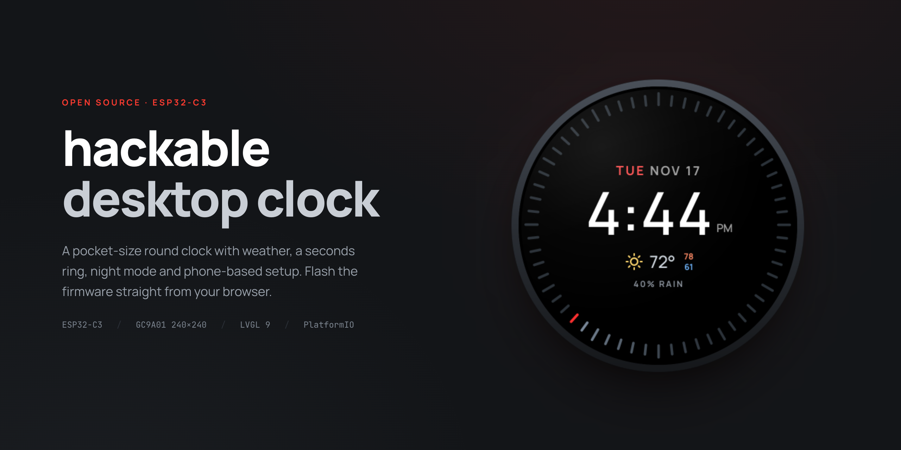
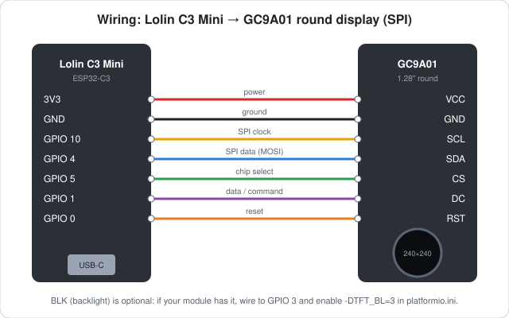
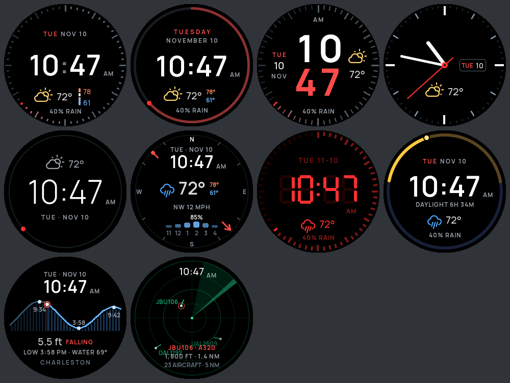

<p align="center"></p>

# hackable-desktop-clock

A digital desk clock for an ESP32-C3 and a 240x240 round GC9A01 display, built with PlatformIO, Arduino and LVGL 9.

- Time over NTP, 12- or 24-hour, with the date
- A **seconds ring** around the rim (its style depends on the face)
- **Weather** from [Open-Meteo](https://open-meteo.com/) (no API key): icon, temperature and the day's high/low, refreshed every 10 minutes
- **Night mode**: everything turns dim red (or amber, or dim white) after sunset or at fixed hours
- **Ten clock faces**: Polished (default), Arc, Stacked, Analog, Zen, Forecast, Retro LCD, Daylight, Tide (high/low tide chart from NOAA predictions for the nearest US tide station, or one you pick on the setup page) and Radar (a radar scope with the live aircraft within 5 NM of your ZIP, from [adsb.fi](https://adsb.fi) ADS-B data; polled every 10 s only while the face is showing). Tap the BOOT button to switch; themes, ring style and night colour are on the setup page
- **No secrets in the firmware**: WiFi, timezone, time/date format, clock face, colour theme, ZIP code and units are set from your phone through a captive-portal setup page on the clock itself

## What you need

| Part | Notes |
|------|-------|
| ESP32-C3 board | Developed on an ESP32-C3 SuperMini, 4 MB flash. Other ESP32-C3 boards should work with the same pins. |
| GC9A01 round display, 240x240, SPI | The common 1.28" module. The backlight (BLK) pin is optional. |
| USB cable | For flashing; the C3 uses its built-in USB. |

Other boards and displays are possible; see [docs/HARDWARE.md](docs/HARDWARE.md).

## Wiring



| GC9A01 | ESP32-C3 SuperMini GPIO |
|--------|--------------|
| VCC    | 3V3          |
| GND    | GND          |
| SCL    | 10           |
| SDA    | 4            |
| CS     | 5            |
| DC     | 1            |
| RST    | 0            |
| BLK    | 3 (optional) |

BLK is optional: many modules have no such pin (the backlight is always on). If yours does, uncomment `-DTFT_BL=3` and `-DTFT_BACKLIGHT_ON=HIGH` in `platformio.ini`. Pins are build flags in `platformio.ini`. Avoid GPIO 2, 8 and 9 for the display (strapping pins; GPIO 9 is the BOOT button).

## Quick start

1. **Install PlatformIO Core** ([instructions](https://docs.platformio.org/en/latest/core/installation/index.html)) or the PlatformIO IDE extension for VS Code. With [mise](https://mise.jdx.dev), `mise install` sets up PlatformIO and `mise run upload` builds and flashes.
   - **Apple Silicon Macs:** install Rosetta 2 (`softwareupdate --install-rosetta --agree-to-license`). The pinned toolchain only ships x86_64 binaries. Without it the build fails with `Bad CPU type in executable`.
2. **Clone and flash:**
   ```
   git clone git@github.com:blakenoll/hackable-desktop-clock.git   # private repo: needs access to the account
   cd hackable-desktop-clock
   pio run -t upload
   ```
   The first build downloads the toolchain and libraries (a few minutes).
3. **Set it up** (below). Nothing needs editing in the code first.

If the upload can't connect, see [docs/TROUBLESHOOTING.md](docs/TROUBLESHOOTING.md).

## First-time setup

On first boot (or whenever the saved network can't be joined for 20 s) the clock starts its own WiFi access point, **clk-setup-XXXX**. The `XXXX` is the last four hex digits of that board's MAC address, so several clocks being set up at the same time each show a different name (and it stays the same for a given clock).

1. The screen shows the `clk-setup-XXXX` network name and a one-time password. Join that network from your phone.
2. The setup page should pop up. If it doesn't, open `http://192.168.4.1`.
3. Pick your WiFi network (2.4 GHz only) and enter its password, choose a timezone, optionally enter a **US 5-digit ZIP code** for weather (plus, optionally, your **street address**, so weather, tides and the radar centre on your house rather than the middle of the ZIP; it is looked up once via the US Census geocoder), choose °F or °C, and tap **Save & restart**.

Settings are stored in flash and survive reboots and reflashing. To change them later, **hold the BOOT button for 3 seconds** while the clock is running. Apps and scripts can also change them over WiFi through a small JSON API ([docs/API.md](docs/API.md)); its key is shown at the bottom of the setup page. (Holding BOOT *during reset* enters the ROM bootloader instead.) If the setup screen is left idle for 5 minutes and WiFi was saved before, the clock reboots and retries it.

## Using it

- **Date / time / weather:** date on top, time in the middle, weather icon + temperature + a small vertical high/low bar with a dot at the current temperature. A pulsing skeleton placeholder shows in the weather spot during the first fetch.
- **Seconds ring:** elapsed seconds are lit, the current second is bright, upcoming ones are dim.
- **Night mode:** when Open-Meteo says it's dark (`is_day = 0`) everything switches to red tones. It needs a ZIP code, since the flag comes from the weather fetch. The last state is remembered across reboots.
- **No ZIP entered:** weather and night mode are simply off.
- **Night mode options (setup page):** follow sunset (default), fixed hours (works without a ZIP), or never; night colour red, amber or dim white.

## Faces

<p align="center"></p>

Top row: Polished, Arc, Stacked, Analog. Middle row: Zen, Forecast, Retro LCD, Daylight. Bottom: Tide, Radar. **Tap BOOT** to step through them, **double-tap** to cycle colour themes (both saved), or pick one on the setup page. The setup page also has colour themes, seconds as digits, the hourly chime and the weather detail line. Night versions and option examples: [night](docs/faces/night.png), [options](docs/faces/options.png), [states](docs/faces/states.png). These images are rendered from the real UI code by `sh docs/tools/sim/render.sh`.

## Make it yours

[docs/CUSTOMIZING.md](docs/CUSTOMIZING.md) maps each common change to the exact file and function: colours and themes, layout, faces, the seconds ring, fonts, weather icons and text, refresh intervals, timezones, adding settings to the setup page, and more. [docs/ARCHITECTURE.md](docs/ARCHITECTURE.md) explains how the pieces fit together.

### Working with Claude Code

This repo ships [Claude Code](https://claude.com/claude-code) skills in `.claude/skills/`, so an AI assistant opened in this folder knows how to build, flash and safely change the clock:

| Skill | Use it to |
|-------|-----------|
| `customize-clock` | change the look or behavior (colors, layout, formats, weather, settings) |
| `change-hardware` | adapt to a different display, pins or ESP32 board |
| `flash-clock` | build, flash and read serial output without tripping on the known gotchas |

`CLAUDE.md` (also linked as `AGENTS.md` for other agents) is the map those skills start from: where to change what, the rules, and the build gotchas. The skills can't see the screen, so they will ask you to check changes on the real display.

## Project layout

| Path | What it is |
|------|------------|
| `src/main.cpp` | Boot flow and main loop |
| `src/tuning.h` | Timings and thresholds (refresh intervals, timeouts, button timings) |
| `src/config.*`, `src/config_fields.h` | Saved settings (NVS); `config_fields.h` lists every setting once |
| `src/setup/` | Setup mode: access point + captive portal (`portal.cpp`), the setup page (`form.cpp`), timezones (`zones.cpp`) |
| `src/api/` | Settings API over WiFi: JSON endpoints, mDNS, API key ([docs/API.md](docs/API.md)) |
| `src/hw/` | Display (TFT_eSPI -> LVGL) and the BOOT button |
| `src/data/` | Background fetches: weather (Open-Meteo), tides (NOAA), aircraft (adsb.fi); `weather_format.cpp` turns data into icons and text |
| `src/ui/` | Everything drawn, behind `ui.h`. `faces/face_*.cpp` is one file per face; the file list is at the top of `src/ui/ui_internal.h` |
| `src/ui/fonts/` | Generated Manrope and Weather Icons fonts ([README](src/ui/fonts/README.md)) |
| `include/lv_conf.h` | LVGL config |
| `fix_tft.py` | Build-time patch for a TFT_eSPI/ESP32-C3 crash; see [docs/HARDWARE.md](docs/HARDWARE.md) |
| `platformio.ini` | Board, pins, pinned library versions, partition table |
| `docs/` | Guides ([customizing](docs/CUSTOMIZING.md), [architecture](docs/ARCHITECTURE.md), [faces](docs/FACES.md), [data](docs/DATA.md), [API](docs/API.md), [hardware](docs/HARDWARE.md), [troubleshooting](docs/TROUBLESHOOTING.md), [web flasher](docs/WEB_FLASHER.md)), face renders and tools |
| `site/` | The web flasher (GitHub Pages) |

## Credits

Weather icons: [Weather Icons](https://github.com/erikflowers/weather-icons) by Erik Flowers, font licensed under the SIL Open Font License 1.1. `src/ui/fonts/font_weather.c` is a subset of it generated with `lv_font_conv`. Text font: [Manrope](https://github.com/sharanda/manrope), SIL Open Font License 1.1; `src/ui/fonts/font_manrope_*.c` are subsets generated with `lv_font_conv`. Weather data: [Open-Meteo](https://open-meteo.com/) (free for non-commercial use; see their terms). Aircraft data: [adsb.fi](https://adsb.fi) open data API ([terms](https://github.com/adsbfi/opendata): personal, non-commercial use, with attribution).

## License

[MIT](LICENSE) © 2026 Blake Noll. The weather-icon font data in `src/ui/fonts/font_weather.c` is derived from Weather Icons and remains under the SIL Open Font License 1.1 (see Credits). Third-party libraries (LVGL, TFT_eSPI, the Arduino core) keep their own licenses.
