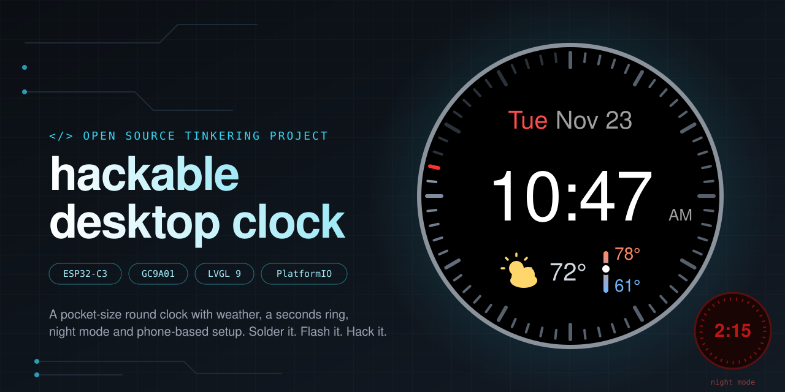
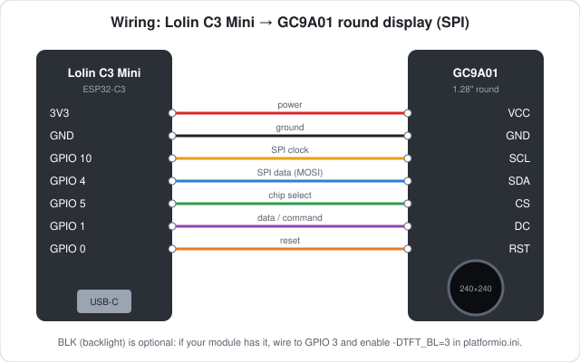

<p align="center"></p>

# hackable-desktop-clock

A digital desk clock for an ESP32-C3 and a 240x240 round GC9A01 display, built with PlatformIO, Arduino and LVGL 9.

- Time over NTP, 12-hour, with the date above it
- A 60-tick **seconds ring** around the rim
- **Weather** from [Open-Meteo](https://open-meteo.com/) (no API key): icon, temperature and the day's high/low, refreshed every 10 minutes
- **Night mode**: everything turns dim red after sunset
- **No secrets in the firmware**: WiFi, timezone, time/date format, accent colour, ZIP code and units are set from your phone through a captive-portal setup page on the clock itself

## What you need

| Part | Notes |
|------|-------|
| ESP32-C3 board | Developed on an ESP32-C3 SuperMini, 4 MB flash. Other ESP32-C3 boards should work with the same pins. |
| GC9A01 round display, 240x240, SPI | The common 1.28" module. The backlight (BLK) pin is optional. |
| USB cable | For flashing; the C3 uses its built-in USB. |

Other boards and displays are possible; see [docs/HARDWARE.md](docs/HARDWARE.md).

## Wiring



| GC9A01 | ESP32-C3 SuperMini GPIO |
|--------|--------------|
| VCC    | 3V3          |
| GND    | GND          |
| SCL    | 10           |
| SDA    | 4            |
| CS     | 5            |
| DC     | 1            |
| RST    | 0            |
| BLK    | 3 (optional) |

BLK is optional: many modules have no such pin (the backlight is always on). If yours does, uncomment `-DTFT_BL=3` and `-DTFT_BACKLIGHT_ON=HIGH` in `platformio.ini`. Pins are build flags in `platformio.ini`. Avoid GPIO 2, 8 and 9 for the display (strapping pins; GPIO 9 is the BOOT button).

## Quick start

1. **Install PlatformIO Core** ([instructions](https://docs.platformio.org/en/latest/core/installation/index.html)) or the PlatformIO IDE extension for VS Code. With [mise](https://mise.jdx.dev), `mise install` sets up PlatformIO and `mise run upload` builds and flashes.
   - **Apple Silicon Macs:** install Rosetta 2 (`softwareupdate --install-rosetta --agree-to-license`). The pinned toolchain only ships x86_64 binaries. Without it the build fails with `Bad CPU type in executable`.
2. **Clone and flash:**
   ```
   git clone git@github.com:blakenoll/hackable-desktop-clock.git   # private repo: needs access to the account
   cd hackable-desktop-clock
   pio run -t upload
   ```
   The first build downloads the toolchain and libraries (a few minutes).
3. **Set it up** (below). Nothing needs editing in the code first.

If the upload can't connect, see [docs/TROUBLESHOOTING.md](docs/TROUBLESHOOTING.md).

## First-time setup

On first boot (or whenever the saved network can't be joined for 20 s) the clock starts its own WiFi access point, **clk-setup-XXXX**. The `XXXX` is the last four hex digits of that board's MAC address, so several clocks being set up at the same time each show a different name (and it stays the same for a given clock).

1. The screen shows the `clk-setup-XXXX` network name and a one-time password. Join that network from your phone.
2. The setup page should pop up. If it doesn't, open `http://192.168.4.1`.
3. Pick your WiFi network (2.4 GHz only) and enter its password, choose a timezone, optionally enter a **US 5-digit ZIP code** for weather, choose °F or °C, and tap **Save & restart**.

Settings are stored in flash and survive reboots and reflashing. To change them later, **hold the BOOT button for 3 seconds** while the clock is running. (Holding BOOT *during reset* enters the ROM bootloader instead.) If the setup screen is left idle for 5 minutes and WiFi was saved before, the clock reboots and retries it.

## Using it

- **Date / time / weather:** date on top, time in the middle, weather icon + temperature + a small vertical high/low bar with a dot at the current temperature. A pulsing skeleton placeholder shows in the weather spot during the first fetch.
- **Seconds ring:** elapsed seconds are lit, the current second is bright, upcoming ones are dim.
- **Night mode:** when Open-Meteo says it's dark (`is_day = 0`) everything switches to red tones. It needs a ZIP code, since the flag comes from the weather fetch. The last state is remembered across reboots.
- **No ZIP entered:** weather and night mode are simply off.

## Make it yours

[docs/CUSTOMIZING.md](docs/CUSTOMIZING.md) has recipes with exact file locations: 12/24-hour time, date format, colors, layout, fonts, ring style, timezones, weather refresh, new weather icons, adding settings to the setup page, and more.

### Working with Claude Code

This repo ships [Claude Code](https://claude.com/claude-code) skills in `.claude/skills/`, so an AI assistant opened in this folder knows how to build, flash and safely change the clock:

| Skill | Use it to |
|-------|-----------|
| `customize-clock` | change the look or behavior (colors, layout, formats, weather, settings) |
| `change-hardware` | adapt to a different display, pins or ESP32 board |
| `flash-clock` | build, flash and read serial output without tripping on the known gotchas |

`CLAUDE.md` holds the project facts those skills build on. The skills can't see the screen, so they will ask you to check changes on the real display.

## Project layout

| Path | What it is |
|------|------------|
| `src/main.cpp` | Display glue (TFT_eSPI → LVGL), boot flow, main loop |
| `src/ui.cpp`, `src/ui.h` | The clock face, seconds ring, night mode, setup screen |
| `src/weather.cpp`, `src/weather.h` | Open-Meteo geocoding + forecast in a background task |
| `src/provisioning.cpp`, `src/provisioning.h` | Saved settings (NVS), setup AP + captive portal + web form, BOOT long-press |
| `src/font_weather.c` | Generated 26 px weather-icon font (12 glyphs) |
| `src/font_manrope_*.c` | Generated Manrope text fonts (14, 20, 56 px) |
| `include/lv_conf.h` | LVGL config: enabled fonts and widgets, memory |
| `fix_tft.py` | Build-time patch for a TFT_eSPI/ESP32-C3 crash; see [docs/HARDWARE.md](docs/HARDWARE.md) |
| `platformio.ini` | Board, pins, pinned library versions, partition table |
| `docs/` | Customizing, hardware and troubleshooting guides |

## Credits

Weather icons: [Weather Icons](https://github.com/erikflowers/weather-icons) by Erik Flowers, font licensed under the SIL Open Font License 1.1. `src/font_weather.c` is a subset of it generated with `lv_font_conv`. Text font: [Manrope](https://github.com/sharanda/manrope), SIL Open Font License 1.1; `src/font_manrope_*.c` are subsets generated with `lv_font_conv`. Weather data: [Open-Meteo](https://open-meteo.com/) (free for non-commercial use; see their terms).

## License

[MIT](LICENSE) © 2026 Blake Noll. The weather-icon font data in `src/font_weather.c` is derived from Weather Icons and remains under the SIL Open Font License 1.1 (see Credits). Third-party libraries (LVGL, TFT_eSPI, the Arduino core) keep their own licenses.
